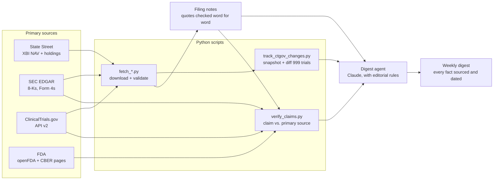

# Biotech Monitor

A weekly research pipeline that tracks 11 biotech companies across SEC filings, ClinicalTrials.gov, FDA records and the XBI biotech ETF. It checks what companies claim against primary sources, and an AI agent turns the results into a digest where every fact carries a source link and a date.

Built by **Shivika Gupta**, University of Pennsylvania (Vagelos Program in Life Sciences & Management).

---

## Why

Biotech press releases are written to persuade. A trial that missed its primary endpoint can still be headlined as "continued slowing of disease progression." Insider-buying totals in a release can differ from what executives reported to the SEC. Catalyst dates get repeated from memory until nobody knows where they came from.

This project treats every company statement as a **claim to be checked**, not a fact, and keeps a paper trail for every number it reports.

## What it has caught so far

From the first runs (October 2026), all public information:

- **An insider-buying figure that does not match the SEC filings.** A company release said its Chief Medical Officer bought 49,016 shares (about $210,000) after its Phase 2a results. His Form 4 filings for the same period show 59,814 shares ($249,998). The gap equals two September purchases. The checker reports both numbers and does not guess why. ([verification report](examples/verification_2026-10-17.md))
- **A headline that outran the data.** A gene therapy release led with "Continued Slowing of Disease Progression," while the pre-specified 48-month primary endpoint "did not reach statistical significance (p=0.144)." ([filing note](data/filing_notes/QURE_2026-09-29.md))
- **A bug in my own checker.** The first verification run double-counted shares, because a Form 4/A restates the original filing it amends. I caught it by reading the raw SEC XML, fixed it, kept the bad report labeled as superseded, and added a test ([`test_verify_claims.py`](tests/test_verify_claims.py)).

## How it works



1. **Fetch.** Each script downloads one source, validates its layout (right fund, right columns, numbers where numbers belong, page counts that add up) and saves it as downloaded.
2. **Track trials.** The ClinicalTrials.gov API only returns each study's current state, so the tracker keeps its own weekly snapshots of 999 watchlist-sponsored trials and diffs them. It flags the changes that matter for catalysts: a trial stopped, enrollment cut 10% or more, completion dates moved, results posted.
3. **Take notes.** Each 8-K gets a filing note with key numbers quoted exactly, promotional language flagged, missing numbers listed, and anything unconfirmed marked "unverified." Every quote is checked against the filing text by script.
4. **Verify.** [`config/claims.json`](config/claims.json) lists claims from the notes, each paired with a check method. `verify_claims.py` runs them against SEC Form 4 XML, later 10-Qs, openFDA, FDA web pages and ClinicalTrials.gov.
5. **Write.** A Claude agent ([`.claude/agents/biotech-digest.md`](.claude/agents/biotech-digest.md)) writes the digest under the rules in [`CLAUDE.md`](CLAUDE.md): a source and date for every fact, nothing from memory, company releases labeled "company-reported," and no buy or sell recommendations.

## Design principles

**Never guess.** If a source is down or its format changes, the script fails with a clear error and saves nothing. A missing number is reported as missing.

**Provenance on everything.** Every saved file gets a `.source.json` sidecar with the URL, the UTC fetch time and a SHA-256 hash ([example](examples/sample_provenance_sidecar.json)). Every attempt, including failures, goes to an append-only log ([example](examples/sample_fetch_log_line.jsonl)). Files are timestamped and never overwritten.

**Claims have a status, not a vibe.**

| Status | Meaning |
|---|---|
| `CONFIRMED` | The primary source matches the claim |
| `PARTIAL` | The source confirms the part it names; the rest stays unverified |
| `CONTRADICTED` | The source disagrees; both numbers are reported |
| `NOT_FOUND` / `PENDING` | Checked and absent / the settling document is not filed yet |
| `NEEDS_READ` / `MANUAL` | Relevant text found for a human to judge / no machine-readable source |

Only `CONFIRMED` claims may appear in the digest without the word "unverified."

**Stricter beats looser.** When a check was too lenient (for example, a web page "confirming" a three-part claim because one term appeared), the fix was an explicit `require_all` mode that downgrades partial matches to `PARTIAL`.

## Example outputs

Real outputs from the 2026-10-17 run:

- [Weekly digest](examples/digest_2026-10-17.md)
- [Claim verification report](examples/verification_2026-10-17.md)
- [Trial change report](examples/ctgov_changes_2026-10-17.md) and [watchlist trial matches](examples/ctgov_watchlist_matches_2026-10-17.md)
- [Filing notes](data/filing_notes/) for 12 8-Ks, and the [catalyst](data/catalysts.csv) and [failure](data/failures.csv) logs

## Watchlist

Three themes, chosen from XBI holdings, with each company description taken from its own 10-K ([`config/watchlist.csv`](config/watchlist.csv)):

| Theme | Companies |
|---|---|
| Neuroscience | Biogen, Denali, Neurocrine, NeOnc |
| Rare disease and gene editing | CRISPR Therapeutics, Beam, Ultragenyx, uniQure |
| Muscle diseases | Sarepta, Dyne, Scholar Rock |

## Running it

Requires Python 3.12.

```bash
make setup                                   # create .venv and install dependencies
export SEC_USER_AGENT="Your Name you@example.com"   # the SEC requires a contact; or put it in config/user_agent.txt
make test                                    # offline test suite
make weekly                                  # run the pipeline; stops at the first failing source
```

The digest step runs the `biotech-digest` agent in [Claude Code](https://claude.com/claude-code).

## Tests

43 offline tests ([`tests/`](tests/)) run on every push via GitHub Actions. They cover the parts where a bug would silently produce a wrong answer:

- Form 4 amendments replacing, not adding to, the filings they amend
- Sponsor name matching (`uniQure Biopharma B.V.` matches uniQure; `Biogenix` does not match Biogen)
- Trial diff flags, including partial registry dates like `2028-07`
- Spreadsheet layout checks that reject a changed or wrong file
- Provenance sidecars, refusal to overwrite, and logged failures

## Limitations

- XBI data is NAV per share from State Street, not the exchange price, and there are no per-stock prices yet, so the digest cannot list top movers.
- The trial tracker sees changes only between its own snapshots, so the exact day of a change is unknown.
- Some sources cannot be automated: FDA approval letters (PDFs), FDA meeting schedules (not public), and Breakthrough or Fast Track designations (not published per product). These are listed as `MANUAL` with where to look.
- Sponsor matching is by name, so a sponsor listed under an unrelated name would be missed.
- This is a research tool, not investment advice.

## Next

- Charts from the saved history (XBI NAV, watchlist weights, catalyst timeline)
- Thesis tracking: per-company theses with the signals that would support or weaken them, checked weekly
- A free, verified source for individual stock prices

## License

[MIT](LICENSE)
